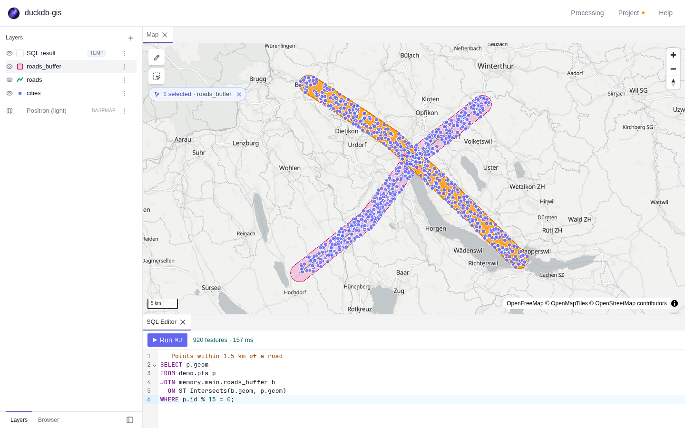

# duckdb-gis

A browser-based GIS built on DuckDB. `duckdb-gis` is a DuckDB **extension**
(C++) that starts a local HTTP server and serves a [MapLibre](https://maplibre.org/)
+ [deck.gl](https://deck.gl/) frontend, letting you explore and run spatial SQL
against your data on a map — QGIS-style, but with DuckDB as the engine.

The north star is to replicate QGIS's core workflows (Layers panel, Browser
panel, geoprocessing tools, feature selection) while keeping all compute
**native and local**: the extension runs the SQL and spatial work in-process,
in the same DuckDB instance — there is no remote backend.



`duckdb-gis` began as a fork of
[`duckdb/duckdb-ui`](https://github.com/duckdb/duckdb-ui) and is now developed as
a standalone project. It still builds on that project's SQL-over-HTTP transport
and TypeScript client, but replaces the hosted UI with our own MapLibre frontend
under `frontend/`.

Bug reports and contributions are welcome — see
[CONTRIBUTING.md](CONTRIBUTING.md).

## Install

> **Not yet listed.** The submission to
> [`duckdb/community-extensions`](https://github.com/duckdb/community-extensions)
> is still in progress, so the command below does not work yet. Until it lands,
> [build from source](#build-from-source).

```sql
INSTALL gis FROM community;
LOAD gis;
CALL start_gis();
```

`start_gis()` starts a local HTTP server and opens your browser. Everything it
serves — the frontend included — is compiled into the extension binary, so it
works offline and makes no outbound network requests.

The extension is named `gis`, which is distinct from DuckDB's own core `ui`
extension: `LOAD ui; LOAD gis;` can coexist in one session.

## What you get

- **Layers panel** — add any table or query with a geometry column as a map
  layer; reorder, toggle, style and zoom to it.
- **Browser panel** — walk the DuckDB catalog and add geometry-bearing tables
  to the map from a right-click menu.
- **SQL editor** — run spatial SQL and render the result set as a temporary
  layer.
- **Select features** — click features on the map to select the underlying rows.
- **Draw and edit** — digitize geometry into a working set, then commit it back
  into a native DuckDB table.

Spatial work uses DuckDB's `spatial` extension and runs in-process. There is no
remote backend and no data leaves your machine.

## Repository layout

- `src/` — the C++ extension, on DuckDB's stable C API: SQL functions
  (`gis_extension.cpp`), HTTP server (`http_server.cpp`) and SQL → Arrow IPC
  (`query.cpp`).
- `frontend/` — the MapLibre/deck.gl GIS frontend (React + Vite). This is the
  point of the project.
- `design-system/` — `@duckdb-gis/ui-kit`, a Storybook workspace for the
  frontend's components. See `design-system/README.md`.
- `test/sql/` — SQL-level extension tests.
- `testdata/` — a deterministic demo database for manual and e2e testing.
  See `testdata/README.md`.
- `scripts/` — build helpers, including the frontend-asset embedder.
- `docs/` — documentation. `docs/requirements/` is the requirements record
  (vision, glossary, register); `docs/adr/` holds architecture decision
  records explaining why the design is the way it is.

## Build from source

The extension is built on DuckDB's stable
[C extension API](https://github.com/duckdb/extension-template-c): it calls
DuckDB only through the function table DuckDB hands it at load time, so it
contains no DuckDB code and **one binary loads on DuckDB 1.4 LTS and every
later release**. The build needs CMake, a C/C++ compiler and Python 3, but no
DuckDB checkout:

```sh
make configure      # once: Python venv with duckdb + the test runner
make                # builds build/release/gis.duckdb_extension
make test_release   # runs test/sql against the duckdb Python package
make test_release DUCKDB_TEST_VERSION=1.4.5   # ...or against another DuckDB
```

The targeted C-API version is `TARGET_DUCKDB_VERSION` in the `Makefile`; the
DuckDB headers it builds against are vendored in `duckdb_capi/`. Load the
result into any DuckDB with `-unsigned`:

```sh
duckdb -unsigned -cmd "LOAD 'build/release/gis.duckdb_extension'"
```

The extension name is `gis` — distinct from DuckDB's own core `ui` extension,
so `LOAD ui; LOAD gis;` both work in the same session.

The built frontend (`frontend/dist/`) is committed and compiled into the
extension binary as gzip-compressed byte arrays (see
`scripts/generate_embedded_assets.py` and the custom command in
`CMakeLists.txt`), so `make` alone never needs Node. If you change anything
under `frontend/src`, refresh the committed bundle first:

```sh
make frontend   # pnpm install && pnpm build in frontend/
make            # picks up the new frontend/dist automatically
```

CI (`.github/workflows/Frontend.yml`) fails the build if `frontend/dist` is
stale relative to `frontend/src`.

## Run

From SQL:

```sql
FROM start_gis();                      -- start the server and open a browser
FROM start_gis_server();               -- start the server without opening a browser
FROM start_gis_server(port := 4300);   -- ...on another port (default 4214, or $GIS_LOCAL_PORT)
FROM gis_is_started();                 -- is the server running?
FROM get_gis_url();                    -- the local URL
FROM stop_gis_server();                -- stop the server
```

The DuckDB shell's `-ui` flag is hardcoded to call `start_ui()`, which this
extension deliberately does not register (that name belongs to DuckDB core's
`ui` extension — registering it too would collide). So `duckdb -ui` does not
launch the GIS UI; use `CALL start_gis();` above. To make `duckdb -ui` launch
this UI, put `.ui_command start_gis()` in your `~/.duckdbrc`.

## Frontend development

`FROM start_gis_server()` serves the frontend embedded in the extension
binary — no network access, works fully offline. During development, run the
Vite dev server with hot-module reload instead, which proxies the
SQL-over-HTTP API to the running extension. From `frontend/`:

```sh
pnpm install
pnpm dev        # Vite dev server on http://127.0.0.1:5173
```

and start the extension server in a DuckDB shell:

```sql
LOAD 'build/release/gis.duckdb_extension';
FROM start_gis_server();   -- binds localhost:4214
```

Then open http://127.0.0.1:5173. Vite proxies `/ddb` to the extension
server, rewriting `Origin` so the extension's same-origin gate is satisfied
(see `frontend/vite.config.ts` and `src/http_server.cpp`). Other scripts:
`pnpm build`, `pnpm typecheck`.

## Architecture

The extension starts an HTTP server that both serves the frontend and runs
SQL. `GET` serves the frontend embedded in the binary (no network access);
`POST /ddb/run` runs the SQL in the request body and returns the last
statement's result as an [Arrow IPC](https://arrow.apache.org/docs/format/Columnar.html#ipc-streaming-format)
stream; `POST /ddb/interrupt` cancels a running query. See
[http_server.cpp](src/http_server.cpp) and [query.cpp](src/query.cpp).

The frontend talks to the server through `frontend/src/lib/duckdb.ts`, which
decodes the Arrow results with `apache-arrow`; the map renders the same Arrow
tables directly. Spatial work is done with DuckDB's `spatial` extension
and rendered via GeoArrow deck.gl layers (`frontend/src/lib/deckRender.ts`).

## Versioning

Releases are tagged `vMAJOR.MINOR.PATCH` and versioned independently of DuckDB —
a release supports whichever DuckDB versions its CI matrix builds against (see
`.github/workflows/MainDistributionPipeline.yml`), rather than mirroring a
DuckDB version number.

Our own releases start at `v0.1.0`.

## License and attribution

MIT — see [LICENSE](LICENSE). The copyright notice is retained from upstream
`duckdb/duckdb-ui` (Stichting DuckDB Foundation), from which this project is
derived. It started from duckdb-ui's extension scaffolding, SQL-over-HTTP
transport and TypeScript client; since the move to DuckDB's stable C API (#88)
the extension, transport and client have been rewritten. duckdb-gis is
developed in a separate repository and does not track upstream.

The offline default basemap is made with [Natural Earth](https://www.naturalearthdata.com)
(public domain) 1:50m data, built by `scripts/build_natural_earth.py` into
`frontend/public/basemaps/natural-earth/`.

DuckDB is a trademark of the DuckDB Foundation. This project is an independent
derivative and is not affiliated with, maintained by, or endorsed by the DuckDB
Foundation or DuckDB Labs. "duckdb-gis" is a descriptive name for a GIS
extension for DuckDB; it does not indicate official status.
